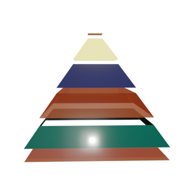
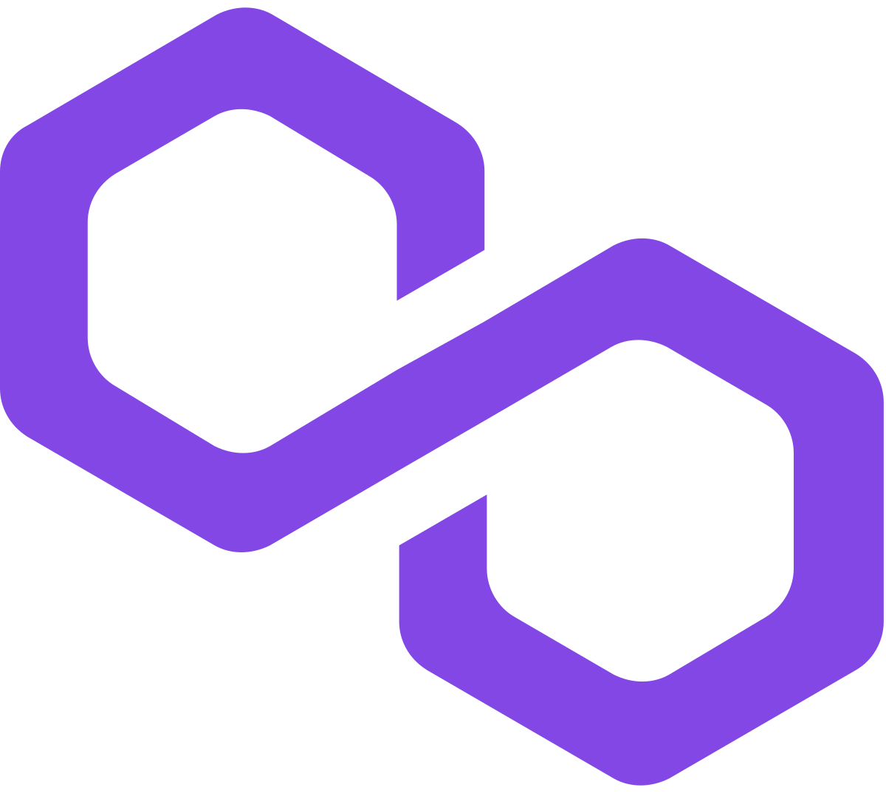

    
    
    
    
    
    
    
    

    <h1>Decent Airdrop DApp</h1>
    <h3>Effortless & Decentralized Airdrops Across Blockchains</h3>

    

---

## 🌟 **Project Description**

**Decent Airdrop DApp** prepares same-chain native/ERC-20 distributions to multiple recipients. Configured deployments exist for **Optimism, Polygon and MintMe**; their source/bytecode provenance still needs independent verification. **Ethereum and Base have no configured deployment and cannot send.** This is not a bridge.

🔹 **Easily distribute tokens** across multiple recipients  
🔹 **Supports multiple blockchain networks** and auto-detects the correct contract  
🔹 **Requests transaction signatures through an EVM wallet**
🔹 **Integrated contract UI for effortless execution**  
🔹 **Decentralized UI hosted on IPFS (soon! 🚀)**  

Use preparation and review before considering a distribution. Wallet integration and tests do not establish contract safety, token compatibility or successful execution.

---

## 🚀 **Features**

✅ **Explicit Network Gates** – Configured Optimism, Polygon and MintMe addresses; no placeholder Ethereum/Base deployments
✅ **Exact Amounts** – Decimal strings, actual token decimals and integer totals; no floating-point transfer amounts
✅ **Custom Token & Native Coin Support** – Airdrop **ERC-20 tokens or ETH/MATIC**  
✅ **MetaMask Integration** – Easily connect and execute transactions  
✅ **Read-Only Preparation** – No wallet connection request, approvals or transfers from the prepare button

---

## 🏗 **How It Works**
1️⃣ **Connect your MetaMask wallet**  
2️⃣ **Select the blockchain in your wallet** (sending requires a configured deployment)
3️⃣ **Enter wallet addresses & airdrop amounts**  
4️⃣ **Choose a token (or use native currency like ETH/MATIC)**  
5️⃣ **Click "Prepare only" to inspect exact totals without transactions. Then explicitly choose "Review and send airdrop" if appropriate.**
6️⃣ **Track the transaction in the blockchain explorer**  

---

## 🛠️ **Technologies Used**
-  **MetaMask**
-  **Solidity Smart Contracts**
-  **Node.js**
-  **IPFS**
-  **Decent Smart Home Ecosystem**

---

## 📅 **Milestones**
### ✅ **Achieved**
- **🚀 Multi-chain contract deployment**  
- **📡 Auto-chain detection & contract selection**  
- **⚡ Integrated Airdrop logic with UI**  
- **🔗 ERC-20 Token Approval System**  
- **🎨 Beautiful and Intuitive UI/UX**  

### 🚧 **Upcoming**
- **📡 Expand to more chains (Arbitrum, zkSync, Base)**  
- **🔗 Decentralized Frontend Hosting via IPFS**  
- **🛠 DAO & Community Airdrop Modes**  
- **📈 Advanced Analytics & Airdrop Tracking**  

---

## 🔗 **Blockchain Contract Addresses**
| Network | Contract Address |
|---------|----------------|
| **Ethereum** | Not deployed/configured; sending blocked |
| **Base** | Not deployed/configured; sending blocked |
| **Optimism** | `0x48Fa7CC60950783820c22392c6F9127cd4eA30f9` |
| **Polygon** | `0x64717B442c6ff1F2f71da09e11ABa7946EE4C5FD` |
| **MintMe** | `0x5436865bF0aC7470d16C14f6B6E6e0F59333A5c9` |

### Readiness and validation

Run `npm test` for exact six-/18-decimal amounts, ABI argument shape, invalid input,
overflow, duplicate rows and the Base deployment gate. Sender regressions use
synthetic DOM/wallet/provider doubles to verify prepare-only has no transaction
side effects, deployment/account guards, cancellation, exact approvals/arguments,
simulation failure and confirmed-versus-reverted receipts. They do not prove
compatibility with deployed bytecode or a real wallet.
Serve the static site over
HTTP to exercise the browser UI; its global ethers API remains v5.

Preparation performs read-only network/token-decimal queries. It is not a
transaction simulation, does not reserve balances and cannot guarantee later
execution. Sending checks bytecode, balances, account/network, then asks for
confirmation. ERC-20 approvals may require a zero-reset followed by approval;
those are separate transactions. Simulation/gas estimation follows approvals.
A failed/cancelled send can leave earlier approvals in place: inspect and revoke
allowances as needed. Gas is additional. Fee-on-transfer/rebasing tokens and
nonstandard contracts require separate compatibility testing.

**Base deployment remains blocked:** recover/review the actual Solidity source,
match existing deployments where claimed, test it locally, select authorized
roles/deployment parameters, then explicitly authorize and verify a Base
deployment before adding its address. No deployment or real transfer was made
as part of this readiness work; this repository currently supplies an ABI, not
reproducible Solidity deployment provenance.

### Reuse decision

Need: precision-safe distribution inputs compatible with the existing
`sendAirdrop` ABI. Adapted the integer scaling approach in DecentBusking
`scripts/payroll.js` (`normalizeAmount` / `amountToUnits`), committed donor
`ab7c1dd4a25479d0b8351e42b17b8fac6c7c0221`. No donor license file was identified
at that commit; no donor module was vendored. The mathematical decimal-scaling
approach is independently implemented here under the receiver's existing
license and attribution. Unlike payroll's fixed ledger precision, this
receiver reads each token's decimals and rejects unsupported precision instead
of rounding. Receiver: `scripts/airdrop-plan.mjs`, tested with `npm test`.
Existing Airdrop ABI and browser UI were adapted, not replaced with a new
contract or framework. Search scope: Canopy leads, Busking payroll, current
Airdrop main and its open failure issue; not a whole-library inventory.

---

## 🤝 **Contributing**
We **welcome contributions!** If you’d like to add features or improve the project, follow these steps:
1️⃣ Fork the repo  
2️⃣ Create a feature branch  
3️⃣ Submit a pull request  

---

## 📞 **Contact**
📩 **Email:** [decentairdrop@protonmail.com](mailto:decentairdrop@protonmail.com)  
🌐 **Website:** [Coming Soon 🚀]  

---

    
    
    
    
    
    
    
    
     
    Keep Your Transactions **Decent**!

## Local DecentHeader integration

`index.html` now uses one themed native DecentHeader with click-only wallet
connect/disconnect, explicit Pinata/Kubo connection checks and project About.
No DBusk widget. Wallet display/network readers and guarded sending reuse
`DecentHead.getWallet()`'s chosen raw provider; sending from this entry never
makes a second account request. Disconnect/account/network changes require
recipient/network review again. Existing prepare-only mode, unsupported/
undeployed-network gates, bytecode/balance/allowance checks and simulation/
confirmed-receipt semantics remain intact; no chain is guessed.

Reuse/adapt: DecentHead `00691c4fe93fd280f5aec780bdc4fac651bfcdb1`
`js/main.js:DecentHead`, `js/wallet.js:WalletSession`, `Header.js`,
`Header/{WalletConnect,IPFSControls,IPFSStatus,AboutModal}.js`, with the exact
`docs/ADOPTING.md` manifest and LICENSE/NOTICE/artwork/ethers attribution in
`vendor/decent-head/2.0.0`. `provenance.json` records adaptations.
Important incompatibility: the existing browser ethers v5 remains untouched;
header v6 runs through module-local CommonJS exports wrapping unchanged donor
UMD bytes. Nullable chain guards observe rather than switch; CSS clips animated
horizontal orbit paint at 375px.

Explicit connectivity uses **uncommitted** shared
`_wt/header-provider-connect` work based on that donor commit:
`IPFSSession.verifyConnection()` and `IPFSControls`' verify-provider handler.
Selection/credentials are not a verified connection; authentication/version
readiness is not recipient-list backup, upload permission, retention or rewards.
All app backup/replication/reward capabilities and generic upload/pinning
controls remain unavailable. Credentials stay header-session only.
Canopy curated leads and relevant receiving worktrees/issues/PRs were inspected
read-only; guarded saved send-flow work was integrated rather than reset.

Validation: `npm test` retains send/prepare/amount tests and adds connected-header
reuse and disconnected-session refusal plus pinned-provider tests.
`node scripts/header-browser-smoke.mjs` with an existing `PLAYWRIGHT_MODULE`
covers the actual entry at 375px, rejection/lifecycle, known/unknown networks,
v5 isolation, unconfigured/401/network/Pinata/Kubo probes without uploads,
and About Escape/focus. Browser wallet/provider responses are synthetic;
helpers self-stop. No funds, deployment, announcements or router changes.

Bounded recovery validation (2026-11-08): preserved the saved precision/send
implementation, including exact BigInt/token-major ABI amounts and all original
15 precision/send regressions (30 total tests with header/provider additions).
Final `npm test` passes **31 tests**, including an added account-change-during-
allowance-read regression that refuses approval and transfer. Existing chain,
bytecode, balance, exact-approval, simulation/gas-estimation and successful-
receipt gates remain intact. The actual header entry makes no redundant wallet
connection request; preparatory queries are explicit and read-only.

The persisted `scripts/header-browser-smoke.mjs` tests the actual `index.html`
at 375px: inert mount/no wallet RPC, prepare-only, no-code/unsupported/Base
send refusal, rejection/connect/account/network/disconnect, isolated ethers-v5,
provider unconfigured/HTTP401/network/Pinata-ready/Kubo-ready, unavailable IPFS
host actions before and after verification, no upload/pin/sign/switch request,
custom About keyboard open/Tab/Escape/focus and dialog bounds. Token/balance
loads now wait for an explicit header session; disconnect clears stale network,
token, summary and timeline displays. Changed-session token responses are
discarded. No automatic approval or transfer was introduced.

Run `npm test` and
`PLAYWRIGHT_MODULE=/absolute/path/to/playwright/index.mjs node scripts/header-browser-smoke.mjs`
from this worktree, then `git diff --check`. Browser tests self-start and close
a bounded loopback server, including browser-launch failure. Wallet/provider
responses and legacy ethers are synthetic fixtures; these checks are not live
deployment/provider validation. Node's existing module-type detection warning
does not fail tests; no manifest/dependency churn was needed.
The saved vendor implementation is reused unchanged from accepted
Escrow/Invoice Head `00691c4fe93fd280f5aec780bdc4fac651bfcdb1` plus explicitly
uncommitted shared `IPFSSession.verifyConnection`/`IPFSControls` additions.
Provenance tests verify unchanged upstream manifest files, exact module-local
donor UMD wrapper and shared probe/UI hashes. The bounded reuse scope covered
Canopy's Airdrop lead, saved receiver source/tests/worktree, accepted header
adaptation and current Airdrop issues/PRs; no open PR was found. The historical
send/album and Supporter issues do not establish a deployed integration.
Backup/replication/rewards remain unavailable; no radio, router changes,
deployment, fund movement or publication occurred.

## License

Code: [Apache-2.0](LICENSE) · Art and docs: [CC BY 4.0](LICENSES/CC-BY-4.0.txt) · Please keep the [NOTICE](NOTICE) and give The Jolly LaMa / A Decent Agency a head nod when you reuse this work.
Support the work with a [Supporter DNFT](https://thejollylama.github.io/DecentMarket/).
